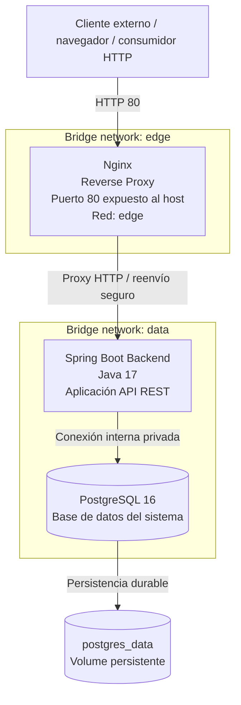

# Taller Docker — EcoAir Backend

Backend Spring Boot de EcoAir, empaquetado en Docker y ejecutado con Docker Compose detrás de Nginx, con PostgreSQL persistente.

## Tecnologías

- Java 17, Spring Boot 3.3.5 y Maven
- Docker Compose
- Nginx como reverse proxy
- PostgreSQL 16
- H2 para ejecución local con Maven
- Spring Data JPA y Spring Boot Actuator

## Arquitectura

```text
Cliente --HTTP:80--> Nginx --red edge--> Backend Spring Boot
                                      Backend --red interna data--> PostgreSQL
```

Solo Nginx publica un puerto al host. El backend no publica `8080` y PostgreSQL no publica `5432`. Nginx y backend comparten la red Bridge `edge`; backend y PostgreSQL comparten la red Bridge interna `data` con acceso privado. La base de datos se persiste con el volumen `postgres_data` para evitar pérdida de datos en reinicios o recreaciones del contenedor.

## Architecture & Container Topology



La topología sigue el principio de mínimo exposure: el cliente accede a la aplicación únicamente a través de Nginx en el puerto 80; el backend queda en una red interna y la base de datos permanece aislada en la red `data`, sin puertos publicados al host. El volumen `postgres_data` garantiza la retención de información ante reinicios, recreaciones o actualizaciones de contenedores.

## Iniciar con Docker Compose

Requiere Docker Desktop o Docker Engine con Docker Compose v2.

En PowerShell:

```powershell
Copy-Item .env.example .env
```

En macOS/Linux:

```bash
cp .env.example .env
```

Edita `.env` y cambia `POSTGRES_PASSWORD` antes de iniciar. La contraseña del ejemplo es solo para desarrollo local.

Construye y levanta los servicios:

```bash
docker compose up --build -d
docker compose ps
docker compose logs --tail=100
```

Compose espera a que PostgreSQL y el backend pasen sus healthchecks antes de arrancar el servicio dependiente.

## Verificar

Nginx es la entrada pública en el puerto 80:

```bash
curl http://localhost/actuator/health
curl http://localhost/api/alertas
```

La respuesta del health endpoint debe contener `"status":"UP"`. Para crear una alerta de prueba:

```bash
curl -X POST http://localhost/api/alertas \
  -H "Content-Type: application/json" \
  -d "{\"estacion\":\"Centro\",\"tipo\":\"PM2.5\",\"valor\":18.4,\"severidad\":\"MODERADA\",\"fecha\":\"2026-10-22T12:00:00Z\"}"
```

Consultar nuevamente `http://localhost/api/alertas` debe mostrar la alerta creada.

## Operación y persistencia

```bash
docker compose ps
docker compose logs -f backend
docker compose logs -f nginx
docker compose restart
docker compose down
```

`docker compose down` elimina los contenedores y redes del proyecto, pero conserva `postgres_data`. No uses `docker compose down -v` salvo que quieras borrar permanentemente la base de datos. Despliega de forma segura con `docker compose up -d` y verifica con `docker compose ps` y `docker compose logs -f`.

Los límites de memoria se pueden ajustar en `.env` (`BACKEND_MEMORY_LIMIT`, `POSTGRES_MEMORY_LIMIT`, `NGINX_MEMORY_LIMIT`). La auditoría local observó mayor margen con `384M` para el backend que soporta adecuadamente la carga; PostgreSQL y Nginx conservan recursos para mantener estabilidad del sistema en un entorno acotado.

## Ejecución local sin Docker

Requiere Java 17 y Maven. Esta ejecución utiliza H2 en memoria:

```bash
mvn spring-boot:run
```

La aplicación queda disponible en `http://localhost:8080`.

## Diferencias frente al flujo anterior

| Antes | Con Docker Compose |
|---|---|
| `docker build` y `docker run` manuales para un único backend | Compose construye y coordina Nginx, backend y PostgreSQL |
| El backend publica `8080` al host | Solo Nginx publica `80`; backend y PostgreSQL no tienen puertos publicados |
| H2 en memoria pierde datos al reiniciar | PostgreSQL usa el volumen `postgres_data` |
| Sin proxy ni redes separadas | Nginx reenvía solicitudes y la base de datos queda en una red interna |
| Verificación manual del contenedor | Healthchecks y dependencias de arranque declaradas en Compose |

La ejecución anterior se conserva en el informe como baseline. Los nuevos resultados de arranque, memoria y salud deben interpretarse para esta topología con PostgreSQL y Nginx.
