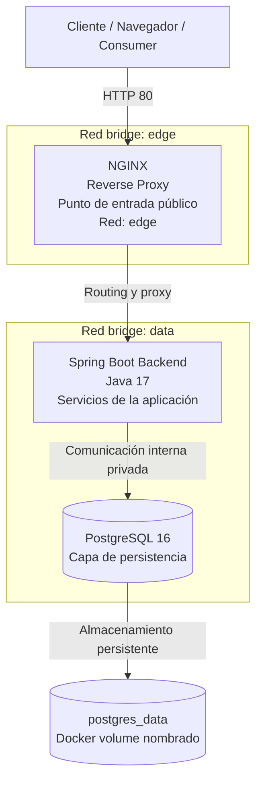

# EcoAir Backend

Backend Spring Boot de EcoAir, diseñado para operar con Docker Compose y Nginx como punto de entrada público, con PostgreSQL como capa de persistencia y redes internas para aislamiento de servicios.

## Autoría y portafolio

- Portfolio: https://oskar-ortiz.vercel.app
- GitHub: https://github.com/oskar-ortiz

## Visión arquitectónica empresarial



### Principios de diseño
- El acceso público queda centralizado en NGINX sobre el puerto 80.
- La capa de aplicación permanece aislada en una red interna del contenedor.
- PostgreSQL no expone el puerto 5432 al host y conserva datos con un volumen dedicado.
- El diseño reduce la superficie de ataque y mejora la seguridad, consistencia operativa y mantenibilidad del sistema.

## Stack tecnológico

- Java 17, Spring Boot 3.3.5 y Maven
- Docker Compose
- NGINX como Reverse Proxy
- PostgreSQL 16
- H2 para ejecución local con Maven
- Spring Data JPA y Spring Boot Actuator

## Requisitos y arranque

Requiere Docker Desktop o Docker Engine con Docker Compose v2.

En PowerShell:

```powershell
Copy-Item .env.example .env
```

En macOS/Linux:

```bash
cp .env.example .env
```

Edita `.env` y cambia `POSTGRES_PASSWORD` antes de iniciar. La contraseña del ejemplo es solo para desarrollo local.

Construye y levanta los servicios:

```bash
docker compose up --build -d
docker compose ps
docker compose logs --tail=100
```

Compose espera a que PostgreSQL y el backend pasen sus healthchecks antes de arrancar el servicio dependiente.

## Verificación

NGINX es la entrada pública en el puerto 80:

```bash
curl http://localhost/actuator/health
curl http://localhost/api/alertas
```

La respuesta del health endpoint debe contener `"status":"UP"`. Para crear una alerta de prueba:

```bash
curl -X POST http://localhost/api/alertas \
  -H "Content-Type: application/json" \
  -d "{\"estacion\":\"Centro\",\"tipo\":\"PM2.5\",\"valor\":18.4,\"severidad\":\"MODERADA\",\"fecha\":\"2026-10-22T12:00:00Z\"}"
```

Consultar nuevamente `http://localhost/api/alertas` debe mostrar la alerta creada.

## Operación y persistencia

```bash
docker compose ps
docker compose logs -f backend
docker compose logs -f nginx
docker compose restart
docker compose down
```

`docker compose down` elimina los contenedores y redes del proyecto, pero conserva `postgres_data`. No uses `docker compose down -v` salvo que quieras borrar permanentemente la base de datos.

Los límites de memoria se pueden ajustar en `.env` (`BACKEND_MEMORY_LIMIT`, `POSTGRES_MEMORY_LIMIT`, `NGINX_MEMORY_LIMIT`). La auditoría local observó mayor margen con `384M` para el backend que soporta adecuadamente la carga; PostgreSQL y NGINX conservan recursos para mantener estabilidad del sistema en un entorno acotado.

## Ejecución local sin Docker

Requiere Java 17 y Maven. Esta ejecución utiliza H2 en memoria:

```bash
mvn spring-boot:run
```

La aplicación queda disponible en `http://localhost:8080`.

## Diferencias frente al flujo anterior

| Antes | Con Docker Compose |
|---|---|
| `docker build` y `docker run` manuales para un único backend | Compose construye y coordina NGINX, backend y PostgreSQL |
| El backend publica `8080` al host | Solo NGINX publica `80`; backend y PostgreSQL no tienen puertos publicados |
| H2 en memoria pierde datos al reiniciar | PostgreSQL usa el volumen `postgres_data` |
| Sin proxy ni redes separadas | NGINX reenvía solicitudes y la base de datos queda en una red interna |
| Verificación manual del contenedor | Healthchecks y dependencias de arranque declaradas en Compose |

La ejecución anterior se conserva en el informe como línea base. Los resultados actuales de arranque, memoria y salud deben interpretarse para esta topología con PostgreSQL y NGINX.
